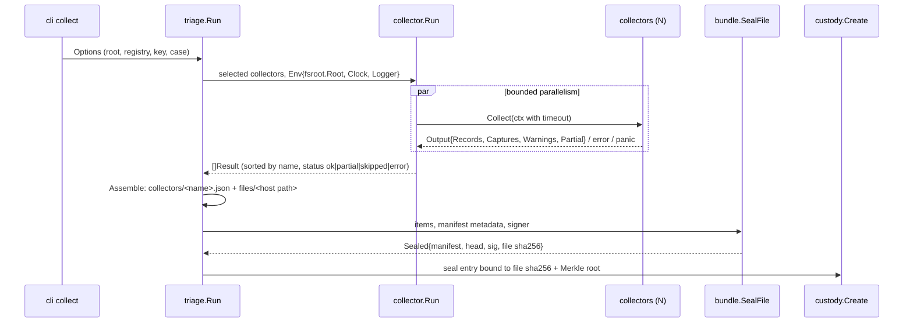

# Architecture

This document covers how evidencelocker is built: the data flow, the
invariants each layer keeps, the key algorithms, and their costs. The
byte-level format is specified separately in [BUNDLE_FORMAT.md](BUNDLE_FORMAT.md),
and the custody model in [CUSTODY.md](CUSTODY.md).

## Data flow



Verification, diffing and proofs only read: `bundle.VerifyFile`,
`baseline.LoadSnapshot` (which refuses unverified bundles), and
`Bundle.Prove`.

## Layers and their invariants

### `pkg/fsroot`: confinement

* Collectors only ever see host-absolute paths ("/etc/passwd") resolved against
  a root directory. `Resolve` implements chroot semantics:
  * an absolute symlink target restarts resolution at the root;
  * `..` at the root stays at the root;
  * hops are capped at 40, the same limit as the kernel's `ELOOP`.
* The resolved path contains no symlinks. It is then opened through `os.Root`,
  which refuses any escape. A symlink swapped in by a racing attacker therefore
  produces an error, never an out-of-root read.
* `OpenRegular` uses `Lstat`, then opens the file, then checks `os.SameFile`
  against the opened handle. A file swapped between inspection and reading
  is reported and skipped.
* Cost: `Resolve` performs one `Lstat` per path component plus one per
  symlink hop, so it is O(components + hops).

### `pkg/collector`: plugin contract

```go
type Collector interface {
    Name() string        // [a-z0-9-]+, also the bundle path collectors/<name>.json
    Version() string     // recorded per run in the manifest
    Description() string
    Collect(ctx context.Context, env *Env) (*Output, error)
}
type Record interface { Key() string; Digest() string }
```

* **Key and digest are what make diffing generic.** `Key` identifies the
  same object across two collections (a file path, `mechanism|location|line
  identity`, `proto/addr:port`). `Digest` changes exactly when a meaningful
  attribute changes. File mtimes and PIDs are deliberately excluded.
* **The runner isolates failures.** Each collector runs in its own goroutine
  under a semaphore. A panic is recovered and reported as status `error` with
  the stack logged. `ErrNotApplicable` becomes `skipped`. A timeout from the
  context becomes `error`. `Output.Partial` becomes `partial`. One broken
  collector never costs you the others.
* **Records are stored deterministically.** They are sorted by (key, digest,
  data) before encoding, so the same host yields byte-identical record files.

### Built-in collectors (summary; details in [COLLECTORS.md](COLLECTORS.md))

| Collector | Source | Key | Cost |
|---|---|---|---|
| processes | `/proc/<pid>/{status,cmdline,exe,cwd,stat}` | exe + cmdline | O(P) files |
| sockets | `/proc/net/{tcp,tcp6,udp,udp6}` + `/proc/*/fd/*` links | proto/addr:port | O(S + total fds) |
| users | `/run/utmp` or `/var/run/utmp` (384-byte glibc records) | user@line | O(records) |
| accounts | `/etc/passwd`, `/etc/group` | account name | O(lines) |
| persistence | cron, systemd, launchd, rc files, ld.so.preload, authorized_keys | mechanism\|file[\|line identity] | O(files × size) |
| filehash | walk of key dirs, SHA-256 with a worker pool | path | O(total bytes / workers) |

### `pkg/merkle`: RFC 9162 tree

* Leaf hash = SHA-256(0x00 ‖ data). Node hash = SHA-256(0x01 ‖ left ‖ right).
  The empty tree's root is SHA-256("").
* The tree is built bottom-up, level by level. An unpaired trailing node is
  **promoted unchanged** to the next level. This produces exactly RFC 9162's
  left-balanced tree, which splits at the largest power of two below n.
  `TestMatchesRFCReference` checks this against a direct transcription of the
  recursive MTH/PATH definitions for every n ≤ 130 and every leaf, and
  `TestKnownAnswer` against the RFC 6962 test-suite roots.
* Proof extraction collects the sibling at each level and skips levels where
  the node was promoted. Verification uses the RFC 9162 §2.1.3.2 algorithm.
* Cost: building takes n − 1 node hashes in O(n) time and memory. A proof is
  O(log n) to produce and to verify.

### `pkg/bundle`: seal and verify

**Seal**
1. Items are sorted by path and validated: clean, relative, UTF-8, no NUL,
   no reserved names.
2. Each item is written as a canonical tar entry (fixed mode, uid, mtime 0;
   USTAR or PAX chosen deterministically by `archive/tar`) and hashed.
3. The tree is built over leaf data `LEAF_ENCODING ‖ 0x00 ‖ u32(len path) ‖
   path ‖ u64(size) ‖ sha256`.
4. The manifest (indented JSON) is written, then `head.json` (compact
   canonical JSON pinning the tree size, root, manifest SHA-256 and key id),
   then `head.sig`, an ed25519 signature over
   `"evidencelocker/head-signature/v1\0" ‖ head.json`.
5. The zstd encoder runs with fixed settings (default level, concurrency 1,
   frame CRC), so the output is reproducible: `TestSealDeterministic`.
6. `SealFile` writes to a temporary file, fsyncs it, sets mode 0400 and
   hard-links it into place, so an existing file is never replaced.

Cost: one pass over the payload. Items are held in memory (see Limitations
in the README).

**Verify.** The verifier runs four passes over the file. Memory is bounded by
the metadata entries.

| Pass | Work | Catches |
|---|---|---|
| 0 | SHA-256 of the file | `FILE_DIGEST_MISMATCH` against the digest in the custody seal entry (`verify --custody`) |
| 1 | `scan`: decompress, parse tar, hash each member, buffer the 3 metadata members, drain to EOF so the zstd checksum is always checked | `CONTAINER_CORRUPT`, with the tar span when the tar layer fails |
| — | metadata checks: sig → head → manifest digest → manifest → Merkle root ↔ manifest ↔ head; trust pinning | `SIGNATURE_INVALID`, `UNTRUSTED_KEY`, `HEAD_INVALID`, `MANIFEST_DIGEST_MISMATCH`, `MANIFEST_INVALID`, `MERKLE_ROOT_MISMATCH` |
| — | entry checks against the manifest | `ENTRY_MISSING`, `ENTRY_UNEXPECTED`, `ENTRY_DUPLICATE`, `ENTRY_SIZE_MISMATCH`, `ENTRY_HASH_MISMATCH`, `ENTRY_TYPE_INVALID` |
| 2+3 | `checkLayout`: re-serialise canonical headers plus the archive's own content into a comparator that reads a second decompressed copy, and tee the stream into the sealing encoder | `LAYOUT_NONCANONICAL` (first differing byte, mapped to "tar header/padding of X", trailer, or trailing data); `CONTAINER_NONCANONICAL` |

**Why every byte is covered.**
* Payload content bytes are covered by the entry hashes, which feed the Merkle
  root, which is in the signed head.
* Manifest bytes are covered by the manifest digest in the head. Head bytes
  are covered by the signature.
* Signature-file bytes have a single valid encoding: the file is decoded
  strictly, re-encoded and compared byte for byte, and the base64 must be
  canonical.
* Everything else (header fields, padding, the trailer, data after the
  trailer) is fixed by the canonical layout.
* The compressed bytes are covered by the zstd frame checksum, by
  re-encoding, and by the whole-file digest in the custody seal.

**Localisation.** Each finding carries `Spans` (byte ranges of the
decompressed tar stream). `TestFlipEveryTarByte` flips every byte of an
archive containing a PAX-header entry and an empty entry, with three masks. It
requires that verification fails and that some span contains the flipped
offset.

Verify cost: O(file size) time across the four passes, plus one encode for
the canonical-compression check. On the benchmark machine that is ~2.4× the
time of sealing (see README).

### `pkg/custody`: hash-chained, signed log

* `entry.sig` = ed25519 over `"evidencelocker/custody-signature/v1\0" ‖
  canonical(entry with sig and hash empty)`.
* `entry.hash` = SHA-256(canonical(entry with hash empty)). The hash
  therefore covers the signature.
* `entry.prev` = the previous entry's hash; the genesis entry uses 64 zeros.
* Verification is a single O(n) pass with constant memory beyond the parsed
  entries. It checks canonical encoding, recomputes each hash and signature,
  checks seq/prev linkage, non-decreasing fixed-width timestamps, bundle
  binding, custodian continuity, and the optional seal-key and head anchors.
* `Append` takes an exclusive `flock`, re-verifies the whole log, checks the
  signer is the current custodian, and writes one line with fsync.
  `TestConcurrentAppendsStayLinear` runs 8 concurrent appenders.

### `pkg/baseline`: diff

* `LoadSnapshot` verifies the bundle (`bundle.Open`) and decodes
  `collectors/*.json` and `files/*` in a single verified streaming pass.
* `Compare` groups records by key per collector. A key may repeat, for
  example two identical worker processes. Each key is classified as added,
  removed, or modified (its sorted digest multisets differ). Cost is O(n + m)
  map work plus O(k log k) to sort keys.
* Severity rules (`Rules` map, extensible) decode the typed record and decide
  severity and wording. They can cross-reference the baseline: for example,
  "is this new process's executable known from the baseline's hashes or
  processes?" uses a lookup set built once per comparison. Collectors without
  a rule get a generic low/info finding. If a rule fails, the change falls
  back to the generic rule and a note is added; it is never dropped.
* File-level persistence changes include a line diff computed by LCS over the
  captured baseline and current copies. LCS is O(n·m); inputs are capped at
  2,000 lines, beyond which the diff is summarised.

## Error handling and logging

* Library functions return wrapped errors (`%w`). Verification problems are
  data (`Report.Findings`), not errors, so callers can always show the full
  picture. Errors are reserved for "could not read the input at all".
* Collectors convert per-item failures into warnings and the `partial` status.
  Only failures to read the collector's whole source are returned as errors.
* The CLI logs through `log/slog` to stderr (`--log-level`,
  `--log-format text|json`). Results go to stdout, either as text or as
  `--json`.

## Testing strategy

| Kind | Where |
|---|---|
| Exhaustive tamper sweeps | `pkg/bundle/tamper_test.go`, `pkg/custody` (`TestFlipEveryLogByte`), `tools/tampereval` |
| Structural attacks (remove, insert, duplicate, reorder, truncate, re-sign with another key, re-compress) | `pkg/bundle/bundle_test.go`, `pkg/custody` |
| RFC conformance and properties | `pkg/merkle` (reference oracle, known answers, mutation property) |
| Fuzzing | `FuzzVerifyTar`, `FuzzCustodyVerify`, `FuzzVerifyInclusion`, `FuzzParsePlist`, `FuzzParseCronLine`, `FuzzParseUtmp` (`make fuzz`) |
| Golden fixture expectations | every collector against `testdata/hosts/*`; `TestCompromisedVsBaseline` |
| Fixture integrity | `TestFixturesUpToDate` regenerates the trees and compares them with the committed copies |
| End to end | `internal/cli/cli_test.go`, `examples/customcollector`, `make demo` (asserts every exit code) |
